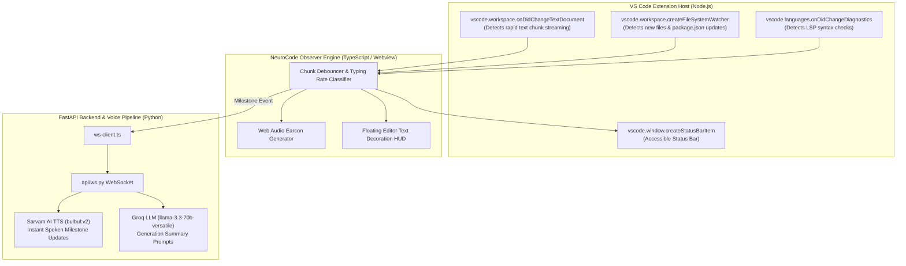

# NeuroCode — Copilot Real-Time Streaming Observer (`STREAM.md`)

## Executive Summary

Standard screen readers (NVDA, JAWS, VoiceOver) stay completely silent while **GitHub Copilot** or automated AI agents generate code, edit files, or update dependencies. This creates a severe accessibility gap—blind developers experience complete "dead air," causing confusion about whether Copilot is actively working, hung, or finished.

**NeuroCode Copilot Observer** (`STREAM.md`) is an audio-first, non-intrusive background observer feature. It monitors Copilot's real-time generation, file creations, and dependency updates, translating background IDE events into **subtle earcon audio streams, floating HUD status banners, and natural voice announcements**.

---

## 🎨 UI/UX Design Architecture: "Co-Pilot Observer Mode"

Since Copilot Chat occupies the primary sidebar panel, NeuroCode operates in **Co-Pilot Observer Mode**—a zero-collision background audio overlay and status bar integration.

```
┌────────────────────────────────────────────────────────────────────────┐
│ VS Code Editor: auth.ts                                                │
│                                                                        │
│ ┌────────────────────────────────────────────────────────────────────┐ │
│ │ 🔊 [NeuroCode Observer] Copilot generating in auth.ts... [⏸️ Mute] │ │  <-- Layer 1: Floating Editor Top HUD
│ └────────────────────────────────────────────────────────────────────┘ │
│ 14 | import { AuthProvider } from './auth';                            │
│ 15 | // Copilot code streaming in real-time...                        │
└────────────────────────────────────────────────────────────────────────┘
┌────────────────────────────────────────────────────────────────────────┐
│ ⚡ NeuroCode Observer: Copilot generated 45 lines in auth.ts (0 errors) │  <-- Layer 2: Accessible Status Bar
└────────────────────────────────────────────────────────────────────────┘
```

### The 4-Layer Observer Interface

1. **Layer 1: Ambient Audio Earcon Stream (Primary Auditory Layer)**
   * **Start Earcon (🎵):** Gentle ascending chime when Copilot begins thinking/generating.
   * **Streaming Pulse (⏱️):** Soft background ticker pulse every 1 second during active code insertion so the developer knows generation is alive.
   * **Completion Earcon (✅):** Satisfying high-pitch chime when generation completes.
   * **Error Earcon (⚠️):** Low double-tone alert if generated code introduces syntax errors.

2. **Layer 2: Floating Editor HUD Banner (Visual Layer for Low-Vision Developers)**
   * Non-intrusive 1-line top banner embedded at the top of the active text editor.
   * **High Contrast (WCAG 2.1 AAA):** Bright cyan/gold text on deep charcoal backdrop.
   * Auto-hides 3 seconds after generation completes to leave screen real estate clear.

3. **Layer 3: Accessible Status Bar Item (Screen Reader Hotkey Access)**
   * Native VS Code Status Bar item (`vscode.window.createStatusBarItem`).
   * Can be read on-demand at any time using standard screen reader shortcuts (`Ctrl+Shift+S` or `Insert+F12`).

4. **Layer 4: Adaptive Mode Switching**
   * **Standard Mode:** Full NeuroCode voice chat & diff review panel when inspecting Git diffs.
   * **Observer Mode:** Automatically engaged when Copilot Chat or inline completion becomes active, hiding sidebar clutter and providing ambient audio updates.

---

## 🛠️ Technical Architecture & Implementation Plan



---

## 💻 Tech Stack & API Usage Details

### 1. VS Code Extension APIs

* **`vscode.workspace.onDidChangeTextDocument(event)`**:
  * Evaluates `event.contentChanges` array. Copilot completions insert multiple characters (e.g., >10 chars per chunk) within <50ms intervals.
  * Differentiates human typing (1 char per ~100-200ms) from AI code generation (>15 chars per chunk).

* **`vscode.workspace.createFileSystemWatcher('**/*')`**:
  * Triggers on `onDidCreate` (new file generated by Copilot agent) and `onDidChange` (`package.json`, `requirements.txt`, `Cargo.toml`).

* **`vscode.languages.onDidChangeDiagnostics(event)`**:
  * Captures real-time Language Server Protocol (LSP) diagnostics immediately after Copilot stops generating to count syntax errors/warnings.

* **`vscode.window.createStatusBarItem(vscode.StatusBarAlignment.Left, 100)`**:
  * Renders accessible live status text read by NVDA/JAWS screen readers.

### 2. Audio Earcon Engine & Web Audio API
* Embedded synthetic audio tone generator using standard Web Audio API oscillators (`OscillatorNode` + `GainNode`) in the webview host.
* Zero network latency (<5ms) for streaming pulse ticks and completion chimes.

### 3. Voice TTS Pipeline (Sarvam AI TTS `bulbul:v2`)
* For major milestones (file creation, package installation, final completion summary), streams low-latency spoken updates over WebSocket (`ws://localhost:7001/ws/session`).

---

## 🤖 Prompts & LLM Specifications

When Copilot completes a multi-file generation or complex refactoring, NeuroCode passes the edit diff summary to Groq LLM (`llama-3.3-70b-versatile`) to generate a **1-sentence screen-reader narration**.

### Prompt Spec 1: Copilot Generation Spoken Summary Prompt

```text
SYSTEM PROMPT:
You are the accessibility voice narrator for NeuroCode.
A blind software developer is using GitHub Copilot. Copilot has just completed an automated code generation session.

Summarize what Copilot generated into EXACTLY ONE short, spoken sentence (max 15 words) suitable for a screen reader or TTS voice engine. Do not use code markdown syntax, special characters, or raw diff markers.

INPUT DATA:
Files Modified: {modified_files_list}
Files Created: {created_files_list}
Lines Added: {lines_added}
Lines Removed: {lines_removed}
LSP Diagnostics: {error_count} errors, {warning_count} warnings

OUTPUT FORMAT:
Return ONLY the plain text spoken sentence.

EXAMPLE OUTPUT:
"Copilot added JWT authentication in auth.ts across 45 lines with zero errors."
```

### Prompt Spec 2: Dependency & File Creation Milestone Prompt

```text
SYSTEM PROMPT:
Generate an instant, 6-word spoken alert for a blind developer when an automated AI agent creates a new file or updates project dependencies.

INPUT:
Action: {action_type} (e.g. file_created | dependency_added)
Target: {target_name} (e.g. src/services/payment.py | jsonwebtoken)

EXAMPLE OUTPUTS:
- "Copilot created new file payment.py."
- "Copilot added dependency jsonwebtoken to package.json."
```

---

## 🚀 Step-by-Step Implementation Roadmap

### Phase 1: Event Detection & Heuristic Classifier (VS Code Host)
1. Create `src/observer/copilot-watcher.ts` in `neurocode-extension`.
2. Register `onDidChangeTextDocument` and calculate insertion character delta per millisecond.
3. Classify AI streaming vs human typing via threshold (`>10 chars per chunk` within `50ms`).

### Phase 2: Auditory Earcon Engine
1. Implement `src/observer/earcon-engine.ts` using Web Audio API synthesis.
2. Wire start chime, streaming pulse tick (1s intervals), and completion chime.

### Phase 3: Status Bar & Floating HUD Banner
1. Implement `src/observer/status-bar.ts` with ARIA live regions for screen readers.
2. Implement `vscode.window.createTextEditorDecorationType` top-banner overlay for low-vision users.

### Phase 4: Backend WebSocket Milestone Voice Pipeline
1. Add `copilot_observer_event` message handler in `backend/api/ws.py`.
2. Connect `SarvamTTSClient` to stream instant milestone audio payloads (`audio_base64`) back to the webview player.
3. Integrate `Groq` 1-sentence generation summary prompt.

---

## 🎯 Verification & Testing Strategy

1. **Automated Unit Tests:**
   * Test AI typing rate classifier with synthetic text document edit events.
   * Verify file watcher regex matching for `.py`, `.ts`, `.js`, `package.json`.
2. **Screen Reader Verification:**
   * Test NVDA / VoiceOver status bar announcement shortcut (`Ctrl+Shift+S`).
   * Confirm zero audio stutter between Web Audio earcon pulse and Sarvam TTS voice narration.
