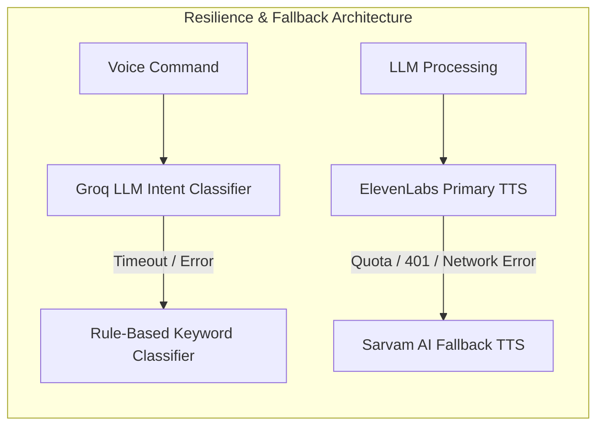

# NeuroCode — Technical Architecture & Technology Description

## Executive Summary

**NeuroCode** is engineered as a hybrid local/cloud system comprising a **TypeScript VS Code Extension Host** and a high-performance **Python FastAPI Backend Engine**. 

This document details the utility, implementation specifics, architectural decisions, and integration mechanics of every core technology powering NeuroCode.

---

## Technology Stack Overview

| Subsystem / Layer | Technology | Version / Model | Implementation File(s) | Primary Technical Utility |
|---|---|---|---|---|
| **Agent Orchestration** | LangGraph | `langgraph >= 0.0.65` | [graph.py](file:///d:/27th%20hackathon%20proj/NeuroCode/backend/agent/graph.py), [state.py](file:///d:/27th%20hackathon%20proj/NeuroCode/backend/agent/state.py) | 7-Node state graph workflow with human-in-the-loop safety pauses. |
| **Backend API Engine** | FastAPI & WebSockets | `fastapi`, `uvicorn`, `websockets` | [main.py](file:///d:/27th%20hackathon%20proj/NeuroCode/backend/main.py), [ws.py](file:///d:/27th%20hackathon%20proj/NeuroCode/backend/api/ws.py) | Low-latency async WebSocket endpoint (`/ws/session`) & audio streaming. |
| **OS Microphone Capture**| `sounddevice` & `numpy` | `sounddevice >= 0.4.6` | [ws.py](file:///d:/27th%20hackathon%20proj/NeuroCode/backend/api/ws.py#L125-L192) | Native OS microphone recording (16kHz PCM), bypassing webview iframe sandboxing. |
| **Speech-to-Text (STT)** | Sarvam AI STT API | `saarika:v2.5` (`en-IN`) | [sarvam_stt.py](file:///d:/27th%20hackathon%20proj/NeuroCode/backend/tools/sarvam_stt.py) | Converts raw 16kHz PCM voice bytes into developer text commands. |
| **LLM & Diff Intelligence**| Groq API / Gemini API | `llama-3.3-70b-versatile` | [diff_intelligence.py](file:///d:/27th%20hackathon%20proj/NeuroCode/backend/tools/diff_intelligence.py), [gemini_llm.py](file:///d:/27th%20hackathon%20proj/NeuroCode/backend/tools/gemini_llm.py) | Sub-second intent classification, diff risk banding, blast radius, commit drafting. |
| **Codebase RAG Engine** | Custom Python RAG | TF-IDF Tokenizer | [rag_engine.py](file:///d:/27th%20hackathon%20proj/NeuroCode/backend/tools/rag_engine.py) | Local workspace file indexing & semantic snippet retrieval without heavy DB dependencies. |
| **Git Operations** | GitPython | `GitPython >= 3.1.40` | [git_tool.py](file:///d:/27th%20hackathon%20proj/NeuroCode/backend/tools/git_tool.py) | Direct local repository tracking, diff analysis, branch switching, commit/push. |
| **Primary Voice TTS** | ElevenLabs API | `eleven_monolingual_v1` | [elevenlabs_tts.py](file:///d:/27th%20hackathon%20proj/NeuroCode/backend/tools/elevenlabs_tts.py) | Risk-modulated voice narration (stability, similarity, style tuned by risk band). |
| **Filler & Fallback TTS** | Sarvam AI TTS API | `bulbul:v2` (`anushka`/`ratan`) | [sarvam_tts.py](file:///d:/27th%20hackathon%20proj/NeuroCode/backend/tools/sarvam_tts.py) | Instant <200ms filler audio for Zero-Silence handoffs and automatic TTS fallback. |
| **IDE Host Bridge** | VS Code Extension Host | TypeScript / Node.js | [extension.ts](file:///d:/27th%20hackathon%20proj/NeuroCode/neurocode-extension/src/extension.ts), [ws-client.ts](file:///d:/27th%20hackathon%20proj/NeuroCode/neurocode-extension/src/ws-client.ts) | Manages IDE context, workspace paths, and WebSocket client bridge. |
| **Accessible Webview UI** | HTML5 / JavaScript | Web Audio API / ARIA | [main.js](file:///d:/27th%20hackathon%20proj/NeuroCode/neurocode-extension/src/webview/main.js) | Dark-mode accessible panel, HTML5 audio playback, live activity log. |

---

## Detailed Technology Implementations & Utility

### 1. LangGraph State Machine Framework

#### Technical Utility
Unstructured LLM agent loops can exhibit non-deterministic behavior, such as accidentally running mutating repository commands (`git push --force`, `git checkout .`) without user authorization. **LangGraph** provides a deterministic state-graph control plane, ensuring that every user command moves through distinct, safety-checked lifecycle nodes.

#### How It Is Implemented
* **Shared State Schema ([state.py](file:///d:/27th%20hackathon%20proj/NeuroCode/backend/agent/state.py)):**
  `AgentState` is defined as a Python `TypedDict` containing:
  * `transcript`: Raw user voice/text input.
  * `intent`: Classified action string (e.g. `git_commit`, `code_query`).
  * `context`: Repository status, working tree diffs, RAG snippets.
  * `reasoning` & `confirmation_required`: Risk analysis evaluation.
  * `confirmed`: Human-in-the-loop approval boolean.
  * `action_result`, `verification_status`, `narration`, `earcon`.
* **7-Node StateGraph Workflow ([graph.py](file:///d:/27th%20hackathon%20proj/NeuroCode/backend/agent/graph.py)):**
  ```python
  builder = StateGraph(AgentState)
  builder.add_node("context", gather_context)     # Entry point
  builder.add_node("understand", understand_intent)
  builder.add_node("reason", reason_plan)
  builder.add_node("confirm", confirm_action)
  builder.add_node("execute", execute_action)
  builder.add_node("verify", verify_action)
  builder.add_node("narrate", narrate_response)
  # Execution order: context → understand → reason → confirm → execute → verify → narrate
  ```
* **Conditional Safety Branching (`should_confirm`):**
  If `confirm` determines that an action mutates repository state (e.g., committing code or switching branches), `should_confirm()` returns `"wait_for_user"`. The graph execution halts immediately, sends a `confirmation_request` payload to the webview UI, and resumes execution only when the user sends a `confirm_response` WebSocket payload.

---

### 2. FastAPI & Async WebSockets

#### Technical Utility
Standard HTTP REST endpoints introduce polling overhead and cannot push real-time status updates (such as microphone state changes or instant filler audio) to the client. **FastAPI WebSockets** enable bi-directional, full-duplex communication between the extension host and Python backend over a single persistent TCP connection.

#### How It Is Implemented
* Endpoint defined at `/ws/session` in [api/ws.py](file:///d:/27th%20hackathon%20proj/NeuroCode/backend/api/ws.py).
* Maintains active in-memory session dictionaries (`session_states`, `session_audio_buffers`, `session_workspaces`).
* Non-blocking graph execution: `asyncio.create_task(run_agent_graph(ws, session_id))` runs the LangGraph loop in the background, allowing the WebSocket receive loop to remain instantly responsive to incoming user interruptions or cancellation commands.

---

### 3. Native OS Microphone Capture (`sounddevice` + `numpy`)

#### Technical Utility
VS Code Webviews run inside sandboxed Chromium `iframe` elements. Security policies inside VS Code block `navigator.mediaDevices.getUserMedia()`, throwing `Permissions policy violation` errors. Attempting to pass microphone streams through VS Code extension APIs is notoriously unreliable.

#### How It Is Implemented
* Implemented in `record_backend_audio()` inside [api/ws.py](file:///d:/27th%20hackathon%20proj/NeuroCode/backend/api/ws.py#L125-L192).
* Uses `sounddevice.InputStream` to capture audio directly from the physical host operating system microphone at **16,000 Hz, 16-bit mono PCM format**.
* Converts `float32` audio chunks into `int16` PCM byte arrays using `numpy`:
  ```python
  pcm_data = (indata * 32767).astype(np.int16).tobytes()
  audio_buffer.extend(pcm_data)
  ```
* Once recording stops, the captured PCM buffer is sent directly to Sarvam AI STT, completely bypassing Chromium iframe sandboxing.

---

### 4. Sarvam AI Speech-to-Text API (`saarika:v2.5`)

#### Technical Utility
Standard web Speech Recognition APIs struggle with technical developer vocabulary, programming syntax, and Indian English accents (`en-IN`). **Sarvam AI STT** (`saarika:v2.5`) provides high accuracy for voice-activated code navigation and developer commands.

#### How It Is Implemented
* Implemented in `SarvamSTTClient` ([sarvam_stt.py](file:///d:/27th%20hackathon%20proj/NeuroCode/backend/tools/sarvam_stt.py)).
* Encapsulates raw PCM bytes in a WAV container header in-memory using `scipy.io.wavfile` or custom byte headers.
* Posts audio to `https://api.sarvam.ai/speech-to-text` with `language_code="en-IN"` and model `"saarika:v2.5"`, returning structured text transcripts within milliseconds.

---

### 5. Groq LLM (`llama-3.3-70b-versatile`) & Gemini API

#### Technical Utility
Evaluating code diffs, classifying intents, drafting conventional commit messages, and generating screen-reader prose require strong reasoning capability. However, cloud LLM latency over standard endpoints (2-4 seconds) causes unacceptable audio lag for voice users. **Groq Llama-3.3-70B** provides ultra-fast inference speeds (over 300 tokens/sec), delivering diff intelligence almost instantly.

#### How It Is Implemented
* Implemented in `DiffIntelligence` ([diff_intelligence.py](file:///d:/27th%20hackathon%20proj/NeuroCode/backend/tools/diff_intelligence.py)) using Groq's OpenAI-compatible endpoint `https://api.groq.com/openai/v1/chat/completions`.
* **Intent Classification Taxonomy:** Classifies freeform voice inputs into 10 structured Git intents (`git_status`, `git_commit`, `git_push`, `git_pull`, `git_branch_create`, `git_branch_switch`, `git_explain_conflict`, `git_review`, `git_undo`, `github_open_pr`) or `code_query`.
* **Diff Risk Banding:** Evaluates diffs and returns `safe`, `caution`, or `high-risk` based on file count, affected functions, and security boundaries.
* **Rule-Based Fallback:** If LLM queries time out or fail, a regex/keyword classifier immediately takes over to ensure system continuity.

---

### 6. Local Codebase Semantic RAG Engine (`rag_engine.py`)

#### Technical Utility
Heavy vector databases (ChromaDB, Pinecone) require long initial indexing steps, heavy background RAM usage, and cloud embedding API calls. **NeuroCode RAG Engine** is a zero-dependency, lightweight local workspace indexer that provides instant semantic code search without cold-start delay.

#### How It Is Implemented
* Implemented in `RAGEngine` ([rag_engine.py](file:///d:/27th%20hackathon%20proj/NeuroCode/backend/tools/rag_engine.py)).
* Crawls the workspace directory, automatically skipping `.git`, `node_modules`, `.venv`, and binary artifacts.
* Tokenizes source files (`.py`, `.ts`, `.js`, `.json`, `.md`) into semantic chunks based on function/class boundaries and line limits.
* Computes TF-IDF term frequency and keyword overlap scores against user query transcripts to extract the top-$k$ relevant codebase snippets in under **50ms**.
* Injects top snippets into Gemini/Groq LLM prompts for context-aware Q&A narration.

---

### 7. GitPython Repository Integration (`git_tool.py`)

#### Technical Utility
Direct interaction with local Git repositories is necessary to check working tree status, generate diffs, inspect branches, create commits, and execute pushes/pulls. Executing shell commands via generic `subprocess` can be error-prone and insecure. **GitPython** provides a safe Python object model over local Git binaries.

#### How It Is Implemented
* Implemented in `GitTool` ([git_tool.py](file:///d:/27th%20hackathon%20proj/NeuroCode/backend/tools/git_tool.py)).
* Dynamically binds to the active VS Code workspace folder path via `_set_repo_path(workspace_path)`.
* Wraps Git operations:
  * `get_status()`: Returns untracked, modified, and staged file lists.
  * `get_diff()`: Generates unified diffs for staged or unstaged changes.
  * `commit()`: Stages files and creates a Git commit with conventional commit messages.
  * `push()` / `pull()`: Handles remote repository synchronization.

---

### 8. Multi-Tier TTS Engine (ElevenLabs + Sarvam AI TTS)

#### Technical Utility
Voice feedback for blind users must be expressive, risk-aware, clear, and **100% resilient**. If a single TTS provider experiences network outages or quota limits, the entire voice interface breaks. NeuroCode uses a dual-engine architecture to guarantee audio playback.

#### How It Is Implemented
* **Sarvam AI TTS — Primary Narration & Zero-Silence Engine ([sarvam_tts.py](file:///d:/27th%20hackathon%20proj/NeuroCode/backend/tools/sarvam_tts.py)):**
  * Model `bulbul:v2`, speakers `anushka` / `ratan`.
  * Serves as the **primary narration engine** in the `narrate` node — called first for all spoken responses.
  * Generates instant <200ms filler audio (*"Processing your request..."*) the moment a voice command arrives, eliminating dead air while LLM computations run.
* **ElevenLabs Fallback TTS ([elevenlabs_tts.py](file:///d:/27th%20hackathon%20proj/NeuroCode/backend/tools/elevenlabs_tts.py)):**
  * Uses `eleven_monolingual_v1` API endpoint.
  * Activates automatically when Sarvam TTS fails or returns empty audio.
  * Modulates voice parameters based on diff risk for expressive narration:
    * `safe`: Stability 0.75, Similarity 0.85 (relaxed, smooth).
    * `caution`: Stability 0.50, Similarity 0.75 (balanced).
    * `high-risk`: Stability 0.30, Style 0.20 (firm, crisp, authoritative alert tone).

---

### 9. VS Code Extension Architecture & Webview Bridge

#### Technical Utility
Integrates the NeuroCode backend seamlessly into the developer's IDE workspace, keeping network operations isolated inside the Extension Host environment.

#### How It Is Implemented
* **Extension Host ([extension.ts](file:///d:/27th%20hackathon%20proj/NeuroCode/neurocode-extension/src/extension.ts)):** Manages extension lifecycle, detects active workspace folders, launches the side-panel webview, and initializes `NeurocodeWsClient`.
* **WebSocket Client ([ws-client.ts](file:///d:/27th%20hackathon%20proj/NeuroCode/neurocode-extension/src/ws-client.ts)):** Maintains a persistent WebSocket link to `ws://localhost:7001/ws/session`, handling auto-reconnects and message serialization.
* **Webview Bridge ([webview-bridge.ts](file:///d:/27th%20hackathon%20proj/NeuroCode/neurocode-extension/src/webview-bridge.ts)):** Relays HTML5 `postMessage` events between Webview UI and `ws-client.ts`.
* **Webview UI ([main.js](file:///d:/27th%20hackathon%20proj/NeuroCode/neurocode-extension/src/webview/main.js)):** Rendered inside Chromium panel. Features base64 MP3 audio decoding, HTML5 audio playback, live status indicators, ARIA live region announcements, and interactive confirmation banners.

---

## Architectural Principles & Resiliency Strategies

```mermaid
### 10. Copilot & Agentic Generation Spectator Engine

#### Technical Feasibility & Utility
Standard screen readers do not announce incremental text buffer edits or background terminal executions during AI code generation (e.g. GitHub Copilot, Copilot Edits, or Claude Code). The **Copilot & Agentic Spectator Engine** observes VS Code environment events in real-time and translates silent AI file edits into auditory milestone feedback for blind developers.

#### VS Code API Event Hooking Strategy
1. **Document Insertion Stream Tracking (`vscode.workspace.onDidChangeTextDocument`):**
   * Computes insertion velocity ($\Delta \text{chars} / \Delta t$). Human keypresses occur at 2–8 chars/sec; AI streaming generation streams at >100 chars/sec.
   * Tracks active target file URI, start/end line ranges, and modified tokens.
2. **File & Dependency System Watcher (`vscode.workspace.createFileSystemWatcher`):**
   * Observes new file creations and dependency edits (`package.json`, `requirements.txt`, `Cargo.toml`, `go.mod`).
3. **Terminal Data & Command Interception (`vscode.window.onDidWriteTerminalData`):**
   * Detects background agentic CLI commands (`npm install`, `pip install`, `pytest`, `cargo build`).
4. **Language Diagnostic Watcher (`vscode.languages.onDidChangeDiagnostics`):**
   * Evaluates post-generation code health to announce syntax or linting errors introduced during generation.

#### Auditory Feedback & Pipeline Flow
```mermaid
graph TD
    Copilot["Copilot / AI Agent Action"] --> Events["VS Code Extension API Events<br/>(onDidChangeTextDocument / createFileSystemWatcher)"]
    Events --> Detector["Velocity & Diff Detector<br/>(Differentiates AI stream vs human typing)"]
    Detector --> Throttle["Auditory Throttle & Debouncer (1.5s interval)"]
    Throttle --> AuditoryEngine["NeuroCode Auditory Engine"]
    AuditoryEngine --> Chimes["Ambient Earcon Ticks (Web Audio API)"]
    AuditoryEngine --> TTS["Spoken Milestone Summary (Sarvam TTS)"]
```

---

## Architectural Principles & Resiliency Strategies



1. **Dual LLM & Rule Fallback:** Ensures that if Groq or Gemini API calls fail, basic voice navigation and Git commands continue operating via rule-based keyword matching.
2. **Dual TTS & Zero-Silence Guarantee:** Guarantees that audio response payloads are generated under all network conditions.
3. **Sandboxed Security Model:** Extension webview never exposes direct network access; all commands pass through the Extension Host and WebSocket validation layers.
4. **Agent Spectator Auditory Debouncing:** Prevents auditory overload by throttling generation progress reports into 1.5-second milestone summaries and ambient audio ticks.
