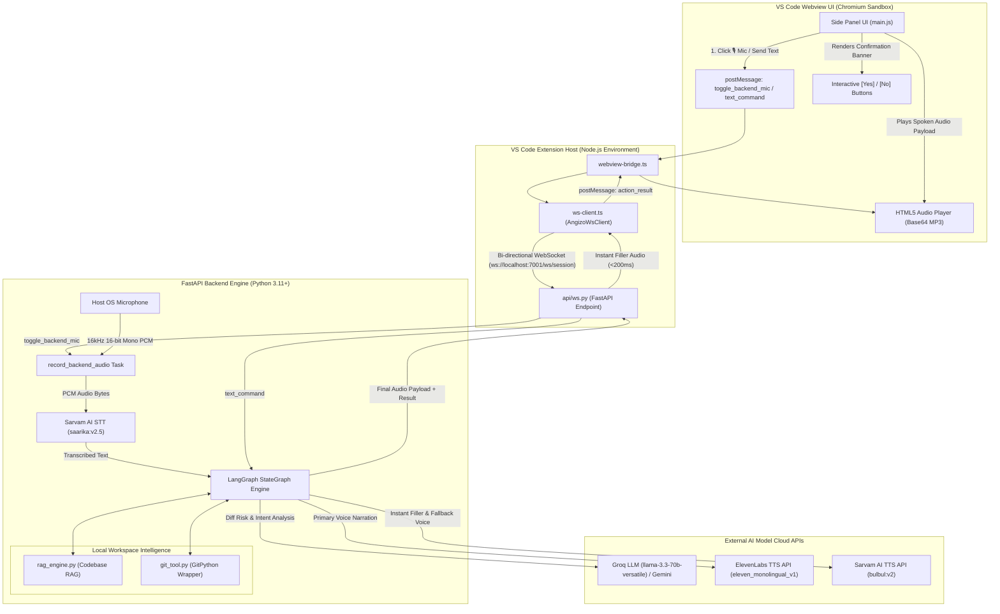
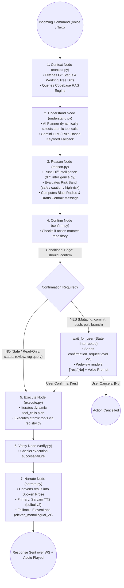
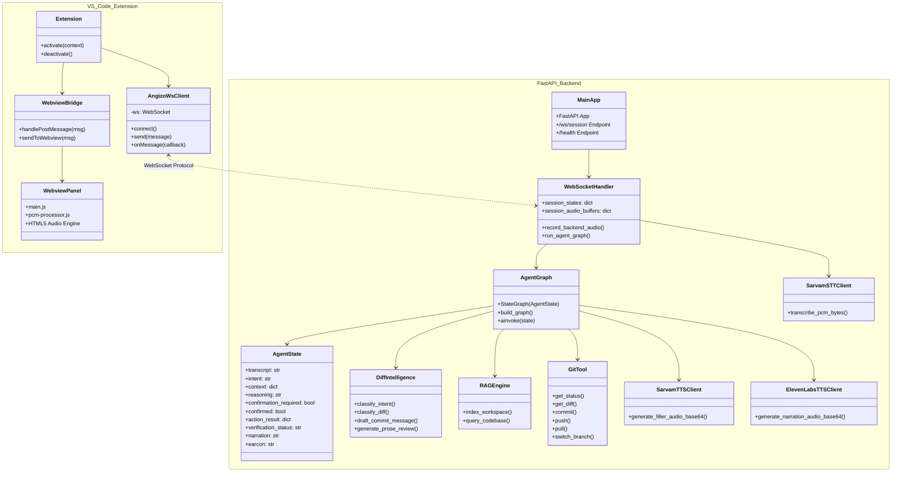
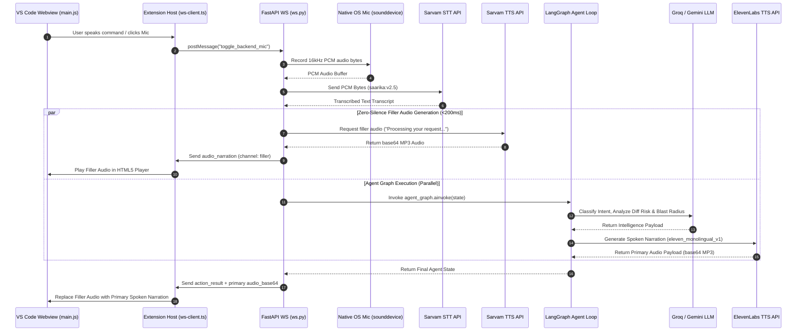

# Angizo Architecture Diagrams & System Topology

This document illustrates the complete system topology, agent workflow, component breakdown, and audio latency management for the **Angizo AI Accessibility Agent**, updated to match the verified implementation across the VS Code extension host and Python FastAPI backend.

---

## 1. End-to-End System Topology & OS Voice Data Flow

This diagram shows how native OS voice capture, WebSocket streaming, Sarvam AI STT, LangGraph state machine, Groq/Gemini LLM intelligence, local RAG/Git tools, and multi-tier TTS narration interact seamlessly across the stack.

---

## 2. Agent Core Loop (LangGraph 7-Node StateGraph Flow)

Angizo orchestrates complex operations through a deterministic 7-node LangGraph `StateGraph`. Safe actions proceed automatically; mutating actions pause at the `confirm` node for human-in-the-loop verification.

---

## 3. Full-Stack Class & Modular Component Breakdown

This diagram shows class relationships across the extension host TypeScript code and FastAPI Python backend.

---

## 4. Zero-Silence Audio Handoff Sequence Diagram

To eliminate silent "dead air" for blind developers, Angizo streams instant filler audio while RAG and LLM processing execute in parallel.

---

## 5. Technology Stack Summary

| Layer / Subsystem | Primary Technology | Model / Library | Key Responsibility in Angizo    |
|---|---|---|---|
| **IDE Extension Host** | TypeScript / Node.js | `vscode` API v1.85+ | Extension lifecycle, window management, webview messaging bridge. |
| **Webview UI** | Vanilla HTML5 / JS | ARIA Live Regions, Web Audio | Accessible dark-mode UI, base64 audio player, recording indicator ring. |
| **Network Bridge** | WebSockets | `ws` (Node.js) / `WebSockets` | Bi-directional streaming connection (`ws://localhost:7001/ws/session`). |
| **Backend Engine** | Python 3.11+ | `FastAPI` + `uvicorn` | Async server, session state management, native OS mic background tasks. |
| **Host Audio Capture** | Native OS Mic API | `sounddevice` + `numpy` | Direct 16kHz Int16 PCM capture bypassing VS Code webview iframe permissions. |
| **Speech-to-Text (STT)** | Sarvam AI STT | `saarika:v2.5` (`en-IN`) | Transcribes technical developer voice commands into text. |
| **Agent Orchestration** | LangGraph | `langgraph` StateGraph | 7-node state machine (`Context` → `Understand` → `Reason` → `Confirm` → `Execute` → `Verify` → `Narrate`). |
| **Diff & Risk LLM** | Groq API / Gemini API | `llama-3.3-70b-versatile` | Diff risk classification (`safe`/`caution`/`high-risk`), conventional commit message drafting, prose review. |
| **Codebase Retrieval** | Custom Local RAG | Token-based TF-IDF | Zero-dependency local file indexing and semantic query retrieval. |
| **Git Operations** | GitPython | `git` binary wrapper | Local repository tracking, diff extraction, branch management, commit/push. |
| **Primary Narration TTS** | Sarvam AI TTS | `bulbul:v2` (`anushka`/`ratan`) | Primary spoken narration in narrate node; instant <200ms filler audio for Zero-Silence handoffs. |
| **Fallback Narration TTS** | ElevenLabs TTS | `eleven_monolingual_v1` | Risk-modulated fallback narration (stability & style parameters tuned by risk band). |
